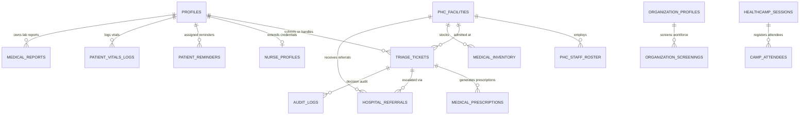

# TriageAssist Healthcare Platform: Database Schema Architecture & Verification Guide

This document presents the complete relational database architecture for **TriageAssist** on PostgreSQL (Supabase). It maps all frontend roles, tables, relationships, Row Level Security (RLS) policies, and dynamic routing contracts.

---

## 1. Executive Role-by-Role Analysis

| # | Role | Primary Routes | Core Responsibilities | Key Database Tables |
|---|---|---|---|---|
| **1** | **Patient** | `/patient`, `/patient/symptoms`, `/patient/timeline`, `/patient/timeline/[id]`, `/patient/reminders`, `/patient/upload`, `/patient/profile` | Self/Family symptom intake, voice triage, viewing live clinical journey, logging vitals, medication adherence, lab report upload. | `profiles`, `triage_tickets`, `patient_reminders`, `patient_vitals_logs`, `medical_reports` |
| **2** | **Nurse** | `/nurse`, `/nurse/intake`, `/nurse/escalations`, `/nurse/ocr`, `/nurse/profile` | Rapid 5-step intake, vitals verification, triaging walk-in patients, initiating doctor handoffs, OCR validation of lab slips. | `nurse_profiles`, `triage_tickets`, `phc_staff_roster`, `phc_facilities` |
| **3** | **Doctor** | `/doctor`, `/doctor/decision`, `/doctor/history`, `/doctor/analytics`, `/doctor/audit` | High-priority patient queue, clinical diagnosis, overriding AI urgency, e-prescriptions, admission or tertiary hospital escalation. | `triage_tickets`, `audit_logs`, `medical_prescriptions`, `hospital_referrals` |
| **4** | **Medical / Pharmacy** | `/medical` | Prescription fulfillment, Jan Aushadhi inventory stock tracking, bed/ICU/oxygen telemetry, receiving and assigning inter-hospital referrals. | `medical_prescriptions`, `medical_inventory`, `hospital_referrals`, `phc_facilities` |
| **5** | **Organization** | `/organization` | Corporate, PSU, and University workforce health tracking, annual screening camps, chronic disease risk tiering, department health indices. | `organization_profiles`, `organization_screenings` |
| **6** | **Health Camp / MMU** | `/healthcamp` | Mobile Medical Unit (MMU) rural outreach, rapid token registration, offline-first screening, immediate CHC referral. | `healthcamp_sessions`, `camp_attendees` |
| **7** | **System Admin** | `/login`, System-wide | Role-based permission controls, facility registry, clinical compliance and audit monitoring. | All tables (`audit_logs`, `profiles`, `phc_facilities`) |

---

## 2. Entity-Relationship (ER) Architecture



---

## 3. Data Dictionary & Table Specifications

### 3.1 `profiles` (Common Table for ALL Roles)
Anchors authentication and personal identity common to all 6 operational roles and admin.
* `id` (`UUID`, PK): Matches Supabase Auth `auth.users.id`.
* `user_id` (`TEXT`, Unique): Universal Role Identifier for all roles (e.g. `PAT-849201`, `DOC-4412`, `NUR-0021`, `ADM-0001`, `ORG-0001`, `CMP-001`, `MED-001`).
* `email` (`TEXT`, Unique): User contact email.
* `full_name` (`TEXT`): Full legal or clinical name.
* `role` (`TEXT`): One of `'patient'`, `'nurse'`, `'doctor'`, `'admin'`, `'organization'`, `'healthcamp'`, `'facility'`, `'medical'`.
* `phone` (`TEXT`): E.164 formatted phone number.
* `gender` (`TEXT`), `date_of_birth` (`DATE`), `age` (`INTEGER`), `address_line1` (`TEXT`), `state` (`TEXT`), `district` (`TEXT`), `city` (`TEXT`), `postal_code` (`TEXT`).

### 3.1.1 Role-Specific Profile Extension Tables
* `patient_profiles`: Patient-specific health data (`blood_group`, `disability`, `primary_facility_name`, `is_affilated_to_org`, `id_in_org`, `org_id_card`, `chronic_conditions`, `allergies`, `dependents`, `emergency_contact_name`, `emergency_contact_phone`).
* `doctor_profiles`: Doctor-specific credentials (`doctor_id`, `medical_registration_number`, `specialization`, `qualification`, `department`, `room_number`, `facility_id`, `shift_timings`, `is_authorized_reviewer`).
* `nurse_profiles`: Nurse-specific credentials (`state_council_reg`, `hpr_id`, `designation`, `facility_id`, `shift_schedule`, `cases_triaged_count`, `doctor_handoffs_count`, `emergency_referrals_count`, `resolved_by_me_count`).
* `facility_profiles`: Facility & pharmacy operations (`staff_id`, `pharmacy_license_number`, `department`, `staff_designation`, `facility_id`, `counter_number`, `is_jan_aushadhi_incharge`).
* `organization_profiles`: Corporate/PSU institutional registry (`org_code`, `name`, `category`, `city`, `total_workforce`, `active_screened`, `contact_email`, `contact_phone`).
* `healthcamp_profiles`: Mobile Medical Unit (MMU) fleets (`camp_id`, `mmu_unit_code`, `camp_name`, `assigned_block`, `district`, `lead_officer`, `operational_status`).

### 3.2 `triage_tickets`
The clinical core of the platform. Tracks patient encounters across their lifecycle.
* `id` (`UUID`, PK): Unique encounter ID.
* `case_number` (`TEXT`, Unique): Human-readable token (e.g. `#LS1024`, `TR-9041`).
* `patient_id` (`UUID`, FK $\rightarrow$ `profiles.id`): The account owner.
* `is_family_member` (`BOOLEAN`): True if logged on behalf of a dependent.
* `family_member_relationship` (`TEXT`): e.g. `'Spouse'`, `'Child'`, `'Parent'`.
* `chief_complaint` (`TEXT`): Patient's primary complaint.
* `vitals` (`JSONB`): `{ bp_sys, bp_dia, pulse, spo2, temp, resp_rate, blood_sugar }`.
* `symptoms` (`JSONB`): `[{ name, duration, severity }]`.
* `urgency` (`TEXT`): `'Immediate'`, `'High Priority'`, `'Yellow (Priority 2)'`, `'Routine'`.
* `status` (`TEXT`):
  1. `Awaiting Nurse Review`
  2. `Forwarded to Doctor`
  3. `Doctor Reviewing`
  4. `Doctor Completed`
  5. `Prescription Ready`
  6. `Dispensed`
  7. `Referrals & Escalations`
* `schedule_time` (`TIMESTAMPTZ`): OPD appointment schedule timestamp.
* `resolve_notes` (`TEXT`): Clinical resolution note recorded when triage case is resolved.
* `reverted_questions` (`JSONB`): Follow-up clinical questions sent back to patient.
* `referal_facility` (`TEXT`): Target hospital/tertiary center for patient referral.
* `referal_facility_id` (`UUID`, FK $\rightarrow$ `profiles.id`): Target facility identifier linking to `profiles` table (`role = 'facility'`).
* `transfer_reason` (`TEXT`): Clinical indication and transfer summary for referral.
* `referred_from_ticket_id` (`UUID`, FK $\rightarrow$ `triage_tickets.id`): Reference to originating ticket when a referral spawns a new triage ticket at receiving facility.
* `referred_from_facility` (`TEXT`): Originating hospital/facility name.
* `patient_referral_status` (`TEXT`): Patient consent status (`'Pending'`, `'Accepted'`, `'Declined'`). Default `'Pending'`.
* `patient_referral_accepted_at` (`TIMESTAMPTZ`): Timestamp when patient accepts the referral.
* `facility_referral_status` (`TEXT`): Target facility intake status (`'Pending'`, `'Accepted'`, `'Declined'`). Default `'Pending'`.
* `facility_referral_accepted_at` (`TIMESTAMPTZ`): Timestamp when target facility accepts the inbound case.
* `referral_notes` (`TEXT`): Clinical intake notes or patient remarks.

### 3.3 Single Source of Truth for Referrals (`triage_tickets`)
All triage and referral workflows are consolidated directly into `triage_tickets` across 4 stages:
1. **Initiation**: Clinician at Facility A refers patient $\rightarrow$ ticket marked with `status = 'Referred'`, `referal_facility`, `referal_facility_id`, `transfer_reason`, `patient_referral_status = 'Pending'`.
2. **Patient Acceptance**: Patient is notified in their portal/app with destination hospital and reason. Patient accepts $\rightarrow$ `patient_referral_status = 'Accepted'`, `patient_referral_accepted_at = now()`.
3. **Inbound Roster Display**: Case appears in the "Hospital Referrals" page of the destination facility (`referal_facility_id`) only after patient acceptance.
4. **Under Review Restart**: Destination facility clicks 'Accept & Start Review' $\rightarrow$ `facility_referral_status = 'Accepted'`, `facility_referral_accepted_at = now()`, `facility_id = referal_facility_id`, `nurse_id = NULL`, `doctor_id = NULL`, `assigned_doctor_name = NULL`, and `status = 'Under Review'`. The patient enters the destination facility's triage queue for clean clinical re-evaluation. When the destination nurse or doctor subsequently takes action, `nurse_id` or `doctor_id` is updated with the new clinician's ID!

### 3.4 `medical_inventory` & `medical_prescriptions`
Powers the Jan Aushadhi dispensary and pharmacy operations in `/medical`.
* Inventory tracks `medicine_name`, `medicine_code`, `category`, `stock_level`, `min_threshold`, `batch_no`, `expiry_date`, `status` (`'In Stock'`, `'Low Stock'`, `'Critical Reorder'`).
* Prescriptions tracks `ticket_id`, `doctor_name`, `medications`, `status` (`'Pending Dispensation'`, `'Fulfilled'`).

### 3.5 `organization_profiles` & `organization_screenings`
Powers the workforce and campus screening analytics in `/organization`.
* Stores employee ID, department, vitals, risk tier (`'Low Risk'`, `'Moderate Risk'`, `'High Risk'`), and preventive interventions.

### 3.6 `healthcamp_sessions` & `camp_attendees`
Powers the rural Mobile Medical Unit (MMU) camps in `/healthcamp`.
* Tracks MMU registration tokens (`#CMP-001`), field vital metrics, immediate on-spot dispensation, or CHC referral.

### 3.7 `audit_logs`
Powers clinical governance in `/doctor/audit`.
* Immutable logging of AI recommendations vs Doctor overrides, recording `previous_urgency`, `final_urgency`, `reason`, and doctor timestamp.

---

## 4. Frontend Dynamic Routing & API Mapping

| Page Route | Dynamic Route / Query Param | Backend API Endpoint | Database Operation |
|---|---|---|---|
| **Patient Dashboard** | `/patient` | `GET /api/triage/patient-tickets?patient_id={id}` | `SELECT * FROM triage_tickets WHERE patient_id = ...` |
| **Symptom Intake** | `/patient/symptoms` | `POST /api/triage/assess` | Computes AI score $\rightarrow$ inserts into `triage_tickets` |
| **Patient Timeline** | `/patient/timeline` | `GET /api/triage/patient-tickets` | Lists all historical encounters |
| **Ticket Details** | `/patient/timeline/[id]` | `GET /api/triage/ticket/{id}` | Fetches single ticket with real-time status |
| **Health Reminders** | `/patient/reminders` | `GET /api/reminders/{patient_id}` | `SELECT * FROM patient_reminders WHERE patient_id = ...` |
| **Vitals Logging** | `/patient/reminders` | `POST /api/reminders/vitals` | `INSERT INTO patient_vitals_logs (...)` |
| **Lab OCR Upload** | `/patient/upload` | `POST /api/ocr/analyze` | Uploads file to bucket $\rightarrow$ inserts into `medical_reports` |
| **Nurse Desk** | `/nurse` | `GET /api/triage/patient-tickets` | Filter by `status = 'Awaiting Nurse Review'` |
| **Nurse Review** | `/nurse?review={case_number}` | `POST /api/triage/nurse-review` | Directly updates `triage_tickets` (`nurse_id`, status, notes) |
| **Doctor Queue** | `/doctor` | `GET /api/triage/patient-tickets` | Filter by `urgency in ('Immediate', 'High Priority')` |
| **Doctor Decision** | `/doctor/decision?id={id}` | `POST /api/triage/override` | Inserts into `audit_logs`, updates ticket with prescription |
| **Medical Referral** | `/medical?tab=referrals` | `GET /api/medical/referrals` | `SELECT * FROM hospital_referrals WHERE target_facility_id = ...` |
| **Assign Doctor** | `/medical?tab=referrals` | `PATCH /api/medical/referrals/{id}` | Assigns `assigned_doctor_id` & sets status to `'Accepted & Assigned'` |

---

## 5. SQL Verification Test Suite

Run these sequential queries in the **Supabase SQL Editor** to verify that tables, triggers, constraints, and relations function properly:

```sql
-- TEST 1: Verify all 17 tables are created
SELECT table_name 
FROM information_schema.tables 
WHERE table_schema = 'public' 
ORDER BY table_name;

-- TEST 2: Verify Seed Profiles exist across all 6 roles
SELECT role, count(*), array_agg(full_name) as sample_users
FROM public.profiles
GROUP BY role;

-- TEST 3: Test Automatic Trigger on New Auth User Signup
INSERT INTO auth.users (id, email, raw_user_meta_data)
VALUES (
  gen_random_uuid(),
  'test.doctor@triageassist.gov.in',
  '{"full_name": "Dr. Test Reviewer", "role": "doctor"}'::jsonb
);

-- Check if profile was automatically created:
SELECT id, email, full_name, role, abha_id, patient_uhid 
FROM public.profiles 
WHERE email = 'test.doctor@triageassist.gov.in';

-- TEST 4: Create a Triage Ticket for a Family Member
INSERT INTO public.triage_tickets (
  case_number, patient_id, patient_name, patient_age, patient_gender,
  is_family_member, family_member_relationship,
  chief_complaint, severity, urgency, status
)
VALUES (
  '#VERIFY-001',
  (SELECT id FROM public.profiles WHERE role = 'patient' LIMIT 1),
  'Sneha Sharma', 10, 'Female',
  true, 'Child',
  'Persistent dry cough and mild breathlessness x 4 days',
  'Moderate', 'Yellow (Priority 2)', 'Awaiting Nurse Review'
)
RETURNING id, case_number, patient_name, family_member_relationship, status;

-- TEST 5: Verify Inter-Hospital Referral Assignment
UPDATE public.hospital_referrals
SET 
  assigned_doctor_id = (SELECT id FROM public.profiles WHERE role = 'doctor' LIMIT 1),
  assigned_doctor_name = 'Dr. Kavita Verma, MD',
  status = 'Accepted & Assigned',
  assignment_notes = 'Assigned to Acute Medicine Ward Bed #4 for Dengue surveillance'
WHERE status = 'Pending Review'
RETURNING id, patient_name, referring_hospital, status, assigned_doctor_name;

-- TEST 6: Verify Medicine Inventory Threshold Query
SELECT medicine_name, stock_level, min_threshold, status
FROM public.medical_inventory
WHERE stock_level <= min_threshold;

-- TEST 7: Verify Cascade Deletion and Constraints
-- Deleting a test ticket should cleanly cascade delete its nurse review actions
BEGIN;
  DELETE FROM public.triage_tickets WHERE case_number = '#VERIFY-001';
ROLLBACK;
```

---

## 6. Next Steps for Implementation

1. **Apply the Migration**:
   Execute the contents of `db/supabase.sql` directly into your Supabase project's **SQL Editor**.
2. **Configure Supabase Test Numbers**:
   Add test phone numbers with fixed OTP `123456` in the Supabase Authentication dashboard as outlined in the auth guide.
3. **Connect Frontend API**:
   Set `NEXT_PUBLIC_SUPABASE_URL` and `NEXT_PUBLIC_SUPABASE_ANON_KEY` in `frontend/.env.local`.
